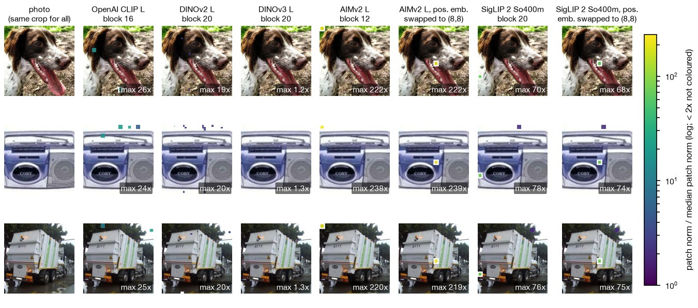
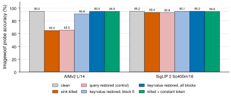
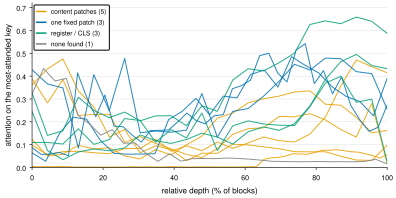
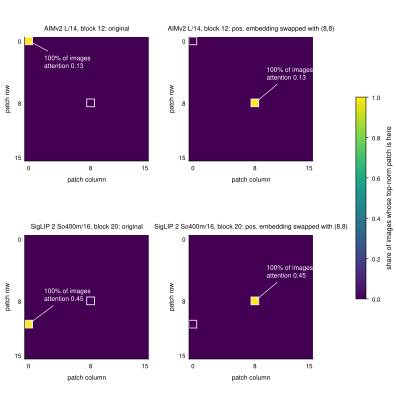
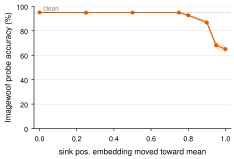
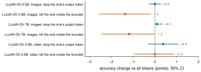

# Hard-coded attention sinks in vision encoders

[](LICENSE)
[](experiments/21-A2-aimv2-key-value/pyproject.toml)
[](https://pytorch.org)
[](https://github.com/huggingface/pytorch-image-models)
[](https://github.com/huggingface/transformers)
[](report/sink-anatomy-report.md#taxonomy-43-checkpoints)
[](experiments)
[](https://modal.com)

Most large vision transformers set aside one token as an **attention sink**: a token that takes a large share of every patch's attention while carrying little image content. Earlier work studied the sinks that land on boring background patches (DINOv2, OpenAI CLIP) or on dedicated register tokens (DINOv2+reg, DINOv3).

This repo shows a third kind that hadn't been mapped. In **AIMv2** (every size) and in **SigLIP So400m / SigLIP 2 So400m and g**, including the vision towers of **PaliGemma** and **LLaVA-OneVision**, the sink is **hard-coded into one learned position embedding**. It sits on the same image patch in every picture, from the first block on. The cleanest way to describe it: one patch of the grid has been turned into an address the rest of the image reads from.

All experiments are on frozen, public checkpoints (via `timm` and `transformers`), run on single Modal GPUs (T4/A10G) for about $16 in total.


## What it looks like



*Each patch coloured by its norm relative to the image's median patch (patches under 2x left uncoloured), on the same photo crop for every model. OpenAI CLIP and DINOv2 put their high-norm sink on a different patch in each photo. DINOv3 has none on the grid (its sink is a register token). AIMv2 always uses the top-left patch at ~230x, and SigLIP 2 So400m always uses patch (11,0) at ~75x. Swap that patch's position embedding with patch (8,8)'s and the sink moves to (8,8) in every photo, same strength. Photos: Imagenette (an ImageNet subset). Data: [run FIG](experiments/29-FIG-sink-maps-on-photos).*

## Main findings



*Killing the hard-coded sink (its position embedding replaced by the mean) breaks AIMv2 and dents SigLIP 2. Restoring only the sink's **key and value**, with the sink token itself left broken, repairs both; restoring its query does not. One constant extra token appended at test time also takes over the job. Imagewoof linear probe, 1000 val images.*

### 1. Where the sink lives is a property of the training recipe

Across 43 checkpoints: content-dependent patches (OpenAI CLIP, DINOv2, SigLIP 2 B/L, PE-Core G), a prefix token (DINOv3 and DINOv2+reg registers, PE-Core CLS), or one hard-coded patch (AIMv2 L/H/1B/3B at (0,0); SigLIP So400m at (12,1) or (21,2); SigLIP 2 So400m at (11,0); SigLIP 2 g at (0,13); the PaliGemma 1/2 towers). Open-data CLIPs (LAION, DFN, MetaCLIP) are the exception: their sink is weak at L and nearly gone at H/G. ([13-K](experiments/13-K-model-scale), [15-K3](experiments/15-K3-vlm-towers), [18-K5](experiments/18-K5-open-data-clip))



*How much attention the single most-attended key gets, by relative depth, for 12 encoders coloured by where their sink lives (OpenAI CLIP, DINOv2, SigLIP 2 L, OpenCLIP L, PE-Core G / AIMv2, SigLIP 2 So400m and g / DINOv2+reg, DINOv3, PE-Core L / OpenCLIP H). PE-Core G spreads its sink over ~12 patches, so its single-key line stays low. 200-300 Imagenette val images, one pass.*

### 2. One position embedding writes it

Swapping the sink patch's position embedding with another patch's moves the sink there in 100% of images at every block, with the same attention mass (AIMv2, SigLIP 2 So400m and g). ([10-G2](experiments/10-G2-pos-embed-swap-massive-channels), [14-K2](experiments/14-K2-siglip2-pos-sinks-clip-pe))



*Where the top-norm patch sits, as a share of 200 Imagenette images. Left: the original model. Right: the same model with the sink patch's position embedding swapped with patch (8,8)'s. The sink, and the attention it receives, moves with the embedding in every image.*

### 3. It runs on a few fixed "massive" channels, as LLM sinks do

In every encoder, the sink's top channel is the same in 100% of images, at roughly 230x to 23,000x a typical patch channel. ([10-G2](experiments/10-G2-pos-embed-swap-massive-channels), [11-H](experiments/11-H-sink-ablation-conservation))

### 4. It works only as a key/value target

Killing it costs AIMv2 28.5 points (94.9 → 66.4, 95% CI −30.9 to −26.2) and SigLIP 2 1.9 points (−2.9 to −1.1). Giving the other patches the clean sink's key and value at every block restores accuracy exactly, even though the sink token itself stays broken. The damage happens inside block 0. ([17-K4-CI](experiments/17-K4-CI-kill-cost-cis), [20-A1](experiments/20-A1-aimv2-collapse), [21-A2](experiments/21-A2-aimv2-key-value), [22-A3](experiments/22-A3-siglip2-key-value))



*Blending AIMv2's sink position embedding toward the mean costs nothing up to 75%, then falls off a cliff. Band: paired-bootstrap 95% CI of the difference from clean, 1000 Imagewoof val images, one probe seed.*

### 5. It can be moved off the image grid without retraining

Kill the position-embedding sink and append one constant token (the average clean sink input): AIMv2 recovers fully (65.0 → 94.9%), SigLIP 2 most of the way (93.4 → 94.6%), and the image patch goes back to being an ordinary patch. Inside a fine-tuned VLM tower (LLaVA-OneVision) the same fix recovers only about 30% of a small loss. ([23-D](experiments/23-D-register-takeover), [28-D-VLM](experiments/28-D-VLM-register-in-llava))

### 6. In a VLM, the sink's output token is junk, but the sink is not

In LLaVA-OneVision 0.5B and 7B (same (21,2) sink, which survives VLM fine-tuning), dropping its output token costs nothing (+0.0 / +0.1 points), while killing it inside the encoder costs 1.2 to 1.4 points on POPE/GQA. Earlier work (SToP) had called these encoder sinks structurally useless; that holds for the output token only. ([24-V](experiments/24-V-llava-ov-pruning), [25-V2](experiments/25-V2-small-k-drop-vs-kill), [26-V3](experiments/26-V3-llava-ov-7b))



*Change in LLaVA-OneVision accuracy (POPE + GQA for images, 1100 questions; TempCompass for video, 1580 questions) when the sink's output token is dropped (blue) or the sink is killed inside the encoder (red). Bars: paired-bootstrap 95% CIs over questions.*

## Negative and partial results

- **Dropping the sink doesn't make token pruning better.** Excluding it from attention-ranked top-k gave no reliable gain on images (k = 4 to 144) or video (TempCompass, 16 frames, k = 8/16). The pooled video sink does sit at exactly the index SToP reported (155). ([25-V2](experiments/25-V2-small-k-drop-vs-kill), [27-VV](experiments/27-VV-video-tempcompass))
- **Attention-ranked token selection was worse than random** at small budgets: by 15 to 20 points at 16 tokens in LLaVA-OneVision 0.5B/7B. This used a simplified VisionZip (no token merging); I read it as several sink-like tokens hogging the ranking, which is SinkPruner's point.
- **A weight-only detector works for AIMv2, not for SigLIP 2.** AIMv2's sink row is a huge outlier among position embeddings (z ≈ 15.8); SigLIP 2's sink row looks ordinary even though swapping it moves the sink. ([19-W](experiments/19-W-weight-only-detector))
- **Test-time registers (Jiang et al.) transfer unevenly**: full for CLIP, at K ≥ 20 for SigLIP 2 L, unstable for DINOv2, failing for AIMv2, with no dense-prediction gain on ADE20K. ([05-E](experiments/05-E-test-time-registers), [06-E2](experiments/06-E2-ttr-dense-ade20k))

Supporting results (outlier tokens carry image-level information, their positions are fragile under invisible noise, resolution scaling, sink conservation) are in the [full report](report/sink-anatomy-report.md).

## Caveats

- Most measurements are single-pass on 200 to 1600 items. Confidence intervals exist for the VLM results (paired bootstrap over questions), the kill costs (3 probe seeds), and the mechanism tests; the core attention map was replicated on a second image set.
- Linear probes are on Imagenette/Imagewoof (10 classes); the costs that matter are reported on Imagewoof because Imagenette is near ceiling.
- VLM tests use LLaVA-OneVision only (PaliGemma weights are gated), a single 384 view for images, greedy decoding, and a simplified VisionZip-style selector.
- Why the sink lands where it does (and why open-data CLIPs mostly lack one) is open; answering it needs training checkpoints that aren't public.

## Repo layout

```
report/
  sink-anatomy-report.md     full write-up, every experiment and run id
  outlier-tokens-report.md   first-pass outlier survey (claim A)
  figures/                   figure scripts + outputs (HTML charts are interactive; open locally)
  data/                      numbers extracted from the run logs
experiments/NN-<code>-<name>/
  NOTES.md                   what the experiment tested and its recorded result
  *.py, pyproject.toml, uv.lock   exact code snapshot that produced the result
```

Each experiment folder is self-contained. To rerun one (GPU needed):

```bash
cd experiments/21-A2-aimv2-key-value
uv run --locked python measure_outliers.py
```

`measure_outliers.py` is the fixed entry point; on each snapshot it dispatches to that experiment's module. Results print to stdout. Datasets (Imagenette, Imagewoof, ADE20K, POPE, GQA, TempCompass) and model weights download on first use.

## Related work this builds on

- Darcet et al., *Vision Transformers Need Registers* (ICLR 2024): high-norm outlier tokens and learned registers.
- Jiang et al., *Vision Transformers Don't Need Trained Registers* ([2506.08010](https://www.alphaxiv.org/abs/2506.08010)): test-time registers.
- SToP, *Sink-Token-Aware Pruning for Fine-Grained Video Understanding* ([2604.20937](https://www.alphaxiv.org/abs/2604.20937)): fixed-coordinate sinks in SigLIP-based video LLMs.
- SinkPruner ([2609.01004](https://www.alphaxiv.org/abs/2609.01004)): high-norm tokens mislead attention-based pruning.
- *Mind the Spike* ([2609.32808](https://www.alphaxiv.org/abs/2609.32808)): massive activations and fixed-position text sinks in LVLMs.
- *Zero-Ablation Overstates Register Content Dependence* ([2604.14433](https://www.alphaxiv.org/abs/2604.14433)): why mean ablation, not zero ablation.

## License

MIT, see [LICENSE](LICENSE). Model weights and datasets keep their own licenses.
